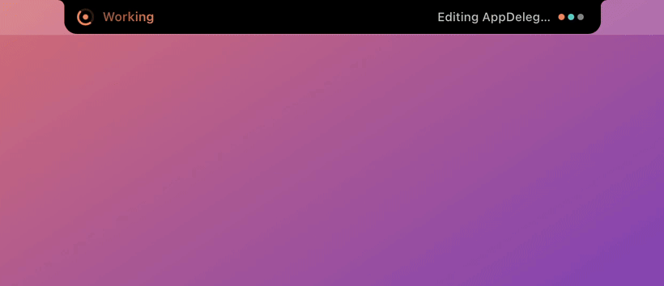
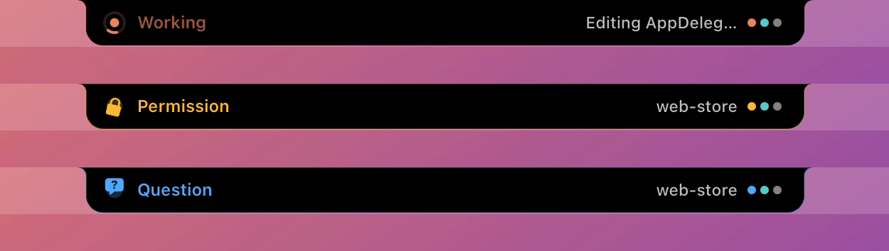
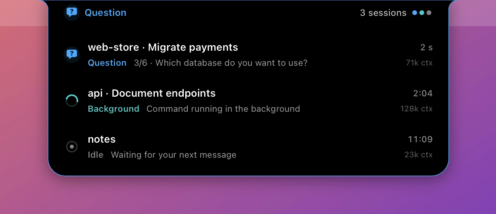
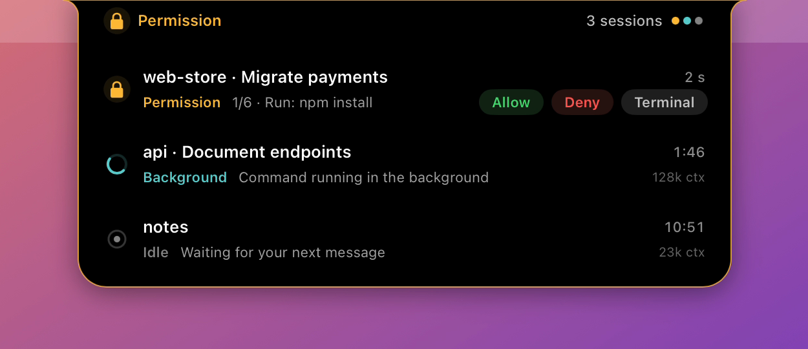

<div align="center">

# Notchling

**Your Claude Code sessions, living in the MacBook notch.**

Stop alt-tabbing to check whether Claude is done, stuck, or waiting for you.
Notchling turns the notch into a tiny status island that tells you at a glance — and taps you on the shoulder when a session needs you.



</div>

## Why

You start a long task in Claude Code, switch to something else, and come back ten minutes later to find it has been waiting for a permission prompt the whole time. Notchling fixes that:

- **See everything at a glance.** The most urgent session sits next to the notch; every other one gets its own colored dot.
- **Never miss a prompt.** When Claude asks for permission, has a question, or wants you to review a plan, the island expands by itself, and a macOS notification follows you even when the notch is out of sight.
- **Approve without switching apps.** Opt in, and permission prompts get **Allow / Deny** buttons right in the island.
- **Know how far along it is.** Task progress (`3/7`) and context usage (`84k ctx`) for every session.
- **Jump straight there.** Click a session, or press **⌃⌥N**, and its terminal comes to the front, down to the exact tab in Terminal and iTerm2.
- **Zero setup.** No config changes and no network by default. Install it and it just finds your sessions.

<p align="center">
  
</p>

## Install

### Download

Requires macOS 14 or later, on Apple silicon or Intel.

1. Download `Notchling.zip` from the [latest release](https://github.com/roberottt/notchling/releases/latest) and unzip it.
2. Move `Notchling.app` to your Applications folder.
3. **Before opening it**, run this in Terminal:

   ```sh
   xattr -dr com.apple.quarantine /Applications/Notchling.app
   ```

4. Open Notchling.

> [!IMPORTANT]
> Step 3 is needed because the app isn't notarized by Apple yet. Without it, macOS says it *"could not verify that Notchling is free of malware"* and won't open it. The command only removes the "downloaded from the internet" flag from Notchling. If you skipped it and already saw that warning, run the command and open the app again, or go to **System Settings → Privacy & Security** and click **Open Anyway**.

### Build from source

Requires the Command Line Tools (`xcode-select --install`). Xcode is not needed.

```sh
git clone https://github.com/roberottt/notchling.git
cd notchling
scripts/build.sh --install   # builds the app, copies it to ~/Applications and opens it
```

To start it with your Mac: menu bar icon → **Open at login**.

## What it shows

<p align="center">
  
</p>

| State | Meaning | Animation |
| --- | --- | --- |
| 🔒 **Permission** | Waiting for you to approve an action | Shaking padlock, pulsing border |
| 💬 **Question** | Waiting for an answer | Bouncing bubble, pulsing border |
| 📋 **Review plan** | A plan is ready for your approval | Beating clipboard, pulsing border |
| ❗ **Needs you** | Waiting for some other reason | Bouncing alert, pulsing border |
| ⚠️ **Error** | The turn ended with an API error | Red triangle |
| 🗂️ **Menu open** | A dialog is open inside the session | Static icon |
| ✅ **Done** | Just finished (for 5 min or until you click) | Check mark drawing itself |
| 🔄 **Working** | Thinking or using tools | Spinning ring, shimmering text |
| ⏳ **Background** | A background command is still running | Slow ring |
| 💤 **Idle** | Doing nothing | Shrinks to the minimum |
| ❔ **Detected** | Session found, but it doesn't publish its state | Static icon |

With several sessions, the most urgent one wins the spot next to the notch.

## Approve permissions from the island

<p align="center">
  
</p>

Turn on **Approve permissions from the island** in the menu and Notchling adds a `PermissionRequest` hook to `~/.claude/settings.json` (after saving a backup next to it). From then on, when a new session needs permission:

- **Allow** or **Deny** answers it from the island, or from the notification.
- **Terminal** hands the question back to Claude Code, as if Notchling weren't there.
- If Notchling is closed, or you don't answer within 45 seconds, Claude Code asks in the terminal as usual. Nothing ever gets stuck.

You only ever approve what you can read in full: a card under the island shows the complete request, and each button answers that exact request. The island handles single-line commands, file reads, URLs and web searches. Everything else goes straight to Claude Code, where you can see it properly: multi-line or very long commands, file edits (the terminal shows the diff), MCP tools, questions and plan reviews. Answering from a notification requires the Mac to be unlocked.

Turn the option off and the hook is removed, leaving the rest of your settings untouched.

## Using it

- **Hover** to expand the list. With more than six sessions, scroll. Rest on a row to read Claude's last message in full.
- **Click a row** to bring the app hosting that session to the front.
- **⌃⌥N** jumps to the session that needs you, or opens the list when nobody does.
- **Right-click a row** to pin it to the top, mute it for an hour, rename it or hide it.
- **Drag** the island anywhere, on any screen. Near a notch it snaps in; pull it away to undock it.
- **Menu bar:** move the pointer to the menu bar outside the notch and the island tucks its wings away so you can reach your app's menus. Toggle it with **Make way for app menus**.
- **Right-click** elsewhere, or use the menu bar icon, for position, notifications, the shortcut, compact mode, language (English / Español) and more.

Automatic placement: in the notch when you only use the laptop screen, top center of the external display when there is one. Each monitor setup remembers its own position.

## How it works

Notchling is fully local and never uses the network. Unless you turn on approvals, it's also read-only: no hooks, nothing written to `~/.claude`. Every 0.4 s it reads:

1. `~/.claude/sessions/<pid>.json`, where Claude Code publishes the state of each session.
2. The process table, to drop dead sessions and find ones using a different `CLAUDE_CONFIG_DIR`.
3. The new lines of each transcript, for the title, the current action, task progress and context usage.

Notifications go through macOS, so Focus modes silence them like any other app's. Approvals use a Unix socket in `~/Library/Application Support/Notchling` that only your user can open.

It's a native app written in Swift with AppKit and Core Animation: no Electron, no web views.

## Limitations

- The session registry is an **internal format** of Claude Code (verified on 2.1.325–2.1.330) and may change. If it does, `Sources/NotchCore/StateResolver.swift` is the place to look.
- Without that registry (older versions), state is inferred from the transcript and **permission prompts can't be detected**. This path has only been tested with simulated data.
- It can't see sessions running in the cloud, over SSH, in containers or VMs, or under other macOS users.
- The exact tab is selected in Terminal and iTerm2 only (macOS asks once for permission to control them). Elsewhere the app comes to the front. `--bg` sessions and sessions inside tmux have no app to activate.
- Context usage is shown in tokens, not as a percentage, because the transcript doesn't say which context window the session uses.
- Approvals only reach sessions using the default `~/.claude` folder and started after you turn the option on.
- Next to the notch it covers any menu that reaches that far while the pointer isn't on the menu bar.
- Builds are signed locally. Distributing a prebuilt app needs a Developer ID and notarization.

## Development

```sh
swift test
scripts/build.sh
build/Notchling.app/Contents/MacOS/Notchling --demo   # cycles through every state with fake sessions
build/Notchling.app/Contents/MacOS/Notchling --dump   # prints what the detector sees, as JSON
```

`Sources/NotchCore` holds detection and geometry; `Sources/Notchling` holds the interface.

## Contributing

Issues and pull requests are welcome. Every PR is reviewed and approved by the maintainer before it's merged.

## License

[MIT](LICENSE)

---

<sub>Notchling is an independent project and is not affiliated with or endorsed by Anthropic.</sub>
